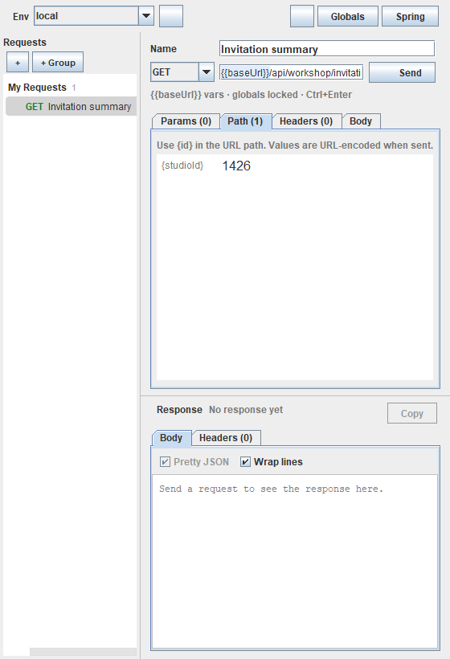
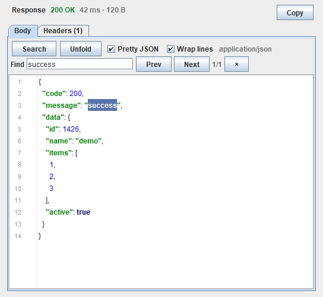

# Smart Request

[](https://github.com/liuzwei/smart-request/actions/workflows/build.yml)
[](LICENSE)
[](https://github.com/liuzwei/smart-request/releases)

一个运行在 IntelliJ IDEA 里的轻量 HTTP 客户端，用来快速测试 Java / Spring 项目中的 Controller。

当前仓库是一个可编译、可运行、可打包的版本，核心链路已经打通：**分组管理请求 → 选择环境 → 解析变量 → 替换 Path 参数 → 合并全局 Header/Params → 发送 HTTP 请求 → 展示响应 → 记录历史/缓存响应**，并支持 Spring Controller 一键导入、变量高亮和自动补全。

## 界面预览



> 截图展示了请求树、请求编辑区、Path 参数和响应区。实际颜色会跟随 IDE 主题变化。



---

## 1. 技术选型：Kotlin + IntelliJ Platform SDK + Swing

使用 **Kotlin** 开发，**`java.net.http.HttpClient`** 负责 HTTP 层。不引入 OkHttp/Jackson 等运行时依赖，插件包小、启动快。

> 构建目标：IntelliJ IDEA **2024.3+**（`since-build=243`），JVM **21**。

---

## 2. 当前已实现的功能

### 请求与分组

- 项目级请求树，支持一级分组。
- 新建、重命名、复制、删除请求和分组。
- 右键请求 → `Move to Group` 移动到其他分组或新建分组。
- 拖拽排序：分组和请求都可以拖动调整顺序。
- 从 Spring 导入的请求右键有 `Go to Source`，跳到 Controller 方法。
- 请求右键 → `Add to Scenario` 把请求直接加入场景。
- 请求编辑：名称、HTTP Method（GET/POST/PUT/PATCH/DELETE/HEAD/OPTIONS）、URL、Query Params、Path Params、Headers、Body（JSON/Text/XML/Form）。
- 表格行支持启用/禁用，禁用行不会发送。

### 变量高亮与自动补全

- URL、Header、Query Params、Path Params、Body 中所有 `{{variable}}` 都有高亮（蓝色已定义，红色未定义）。
- URL 中的 `{pathParam}` 用绿色高亮。
- 输入 `{{` 自动弹出变量补全；`Ctrl+Space` 手动触发。
- Params/Headers/Path Params 的单元格编辑器同样支持补全。
- 切换环境后高亮和补全列表立即刷新。

### 模板函数

`{{...}}` 里可以调用函数做编码、哈希、签名。语法：`{{base64(token)}}`、`{{concat('Bearer ', token)}}`。

内置：`base64`、`urlencode`、`md5`、`sha256`、`hmacSha256`、`rsaEncrypt`、`concat`、`replace` 等编码/哈希/RSA/字符串函数。支持用 `Functions` 面板定义纯宏。

详见 [docs/template-functions.md](docs/template-functions.md)。

### 请求历史与响应缓存

- 每次请求完成记录历史（最近 100 条），包含方法、URL、状态码、耗时和请求快照。
- 历史可恢复为新请求；响应缓存在当前 IDE 会话有效（最多 10 个）。

### 响应提取（Extract）

把响应里的值自动存进当前环境变量，实现"登录拿 token → 下一个请求带上 token"的串联。

- 表达式语法：`data.token`、`data.items[0].id`、`headers.X-Request-Id`、`status`。
- 提取失败不覆盖旧值；变量立即生效，`{{token}}` 的高亮和补全同步刷新。

### 场景编排（Scenarios）

把多个请求串成活动网络图（Start → 请求 → End），一次运行整条链路；上游响应里的值作为下游 `{{变量}}`。

- 左侧 `Scenarios` 区域：新建、重命名、复制、删除、过滤、导入/导出。
- `Steps | Graph` 两种视图：步骤表编辑依赖和属性；画布自由绘制和调整。
- 画布交互：拖拽节点、拖右端口到左端口建边、点击选中、Delete 删除、Ctrl+滚轮缩放、平移、自动布局、Ctrl+Z/Y 撤销重做。
- 画布直接显示运行状态（pending/running/passed/failed/skipped）和 HTTP 状态码。
- 每个步骤可设 `Expect status`、超时、出参规则；出参可标记可选，步骤可选重试（0-5 次）。
- 请求树里的请求可直接拖到画布上创建步骤。
- 运行前静态校验：环、不可达节点、请求已删除、变量数据流；顶部显示状态，点击查看详情。
- 运行后 `Response` Tab 可查看选中步骤的响应（来自本次运行保留数据）。
- 抓取值只存在于本次运行，不写回环境；面板列出最终变量可复制。

### 复制为 cURL

请求右键 → `Copy as cURL`，支持 Linux 和 PowerShell 格式，生成解析后的最终请求。

### 环境（Environment）

- 多环境（local/dev/test/prod），可新增、复制、删除。
- 每个环境有独立的 `baseUrl`、变量、全局 Header 和全局 Query Param。
- 变量支持递归解析：`api = {{baseUrl}}/api`。
- 全局 Header/Param 按环境维护，请求级同名可覆盖。

### URL 与 Params 双向同步

URL 和 `Params` 表格是同一份数据的两个视图，任意一侧改动立刻同步到另一侧。禁用的行保留在表格中但不出现在 URL 也不发送。

### HTTP 请求与响应

- `java.net.http.HttpClient`，异步发送，不阻塞 EDT。
- 发送中可取消；支持 gzip/deflate 解压。
- 响应展示：状态码、耗时、Header、JSON 语法高亮、折叠/展开、搜索高亮。
- 响应体超 5MB 截断显示。

### Spring Controller 导入

- 工具栏 `Spring` 按钮扫描项目中的 Spring MVC Controller。
- 识别 `@RestController`、`@GetMapping`、`@PostMapping` 等注解。
- 按稳定 key 更新已有请求，不覆盖用户编辑的参数和 Body。
- Gutter 图标：Controller 类名和方法名左侧显示图标，一键生成/更新请求。

### 参数表格输入体验

- 列宽随窗口宽度实时伸缩；单击进入编辑态并全选内容直接覆盖。
- Headers 的 Key 列有下拉选择常用 Header 名。
- 全局行灰色斜体不可编辑，悬停提示去 `Environments` 修改。

---

## 3. 快速开始

### 环境要求

- IntelliJ IDEA **2024.3 或更高版本**
- JDK **21**（可使用 IDEA 自带的 JBR）

### 运行插件（开发模式）

```powershell
$env:JAVA_HOME = "C:\Program Files\JetBrains\IntelliJ IDEA OSS\jbr"
.\gradlew.bat runIde
```

启动后在右侧边栏找到 **Smart Request** 工具窗口。

### 安装到日常使用的 IDEA

```powershell
$env:JAVA_HOME = "C:\Program Files\JetBrains\IntelliJ IDEA OSS\jbr"
.\gradlew.bat buildPlugin
```

产物在 `build/distributions/smart-request-<version>.zip`，通过 `Settings → Plugins → ⚙ → Install Plugin from Disk...` 安装。

### 测试

```powershell
$env:JAVA_HOME = "C:\Program Files\JetBrains\IntelliJ IDEA OSS\jbr"
.\gradlew.bat test -PlocalIdePath="C:\Program Files\JetBrains\IntelliJ IDEA OSS"
```

---

## 4. 使用说明

### 第一次使用

1. 打开 `Smart Request` 工具窗口。
2. 顶部 `Env` 选择 `local`，点 `Environments` 修改 Host Address。
3. 选中请求，修改 URL，点 `Send` 或按 `Ctrl+Enter`。

### 变量

请求中写 `{{baseUrl}}/api/users?tenant={{tenantCode}}`，Header 写 `Authorization: Bearer {{token}}`。优先级：请求级 > 全局级。

### 路径参数

URL 里写 `{studioId}`，`Path Params` Tab 自动生成对应行，填入值后发送。修改 URL 时表格自动增删行。

### 从响应提取变量（Extract）

1. 选中登录请求 → `Extract` Tab → `+`。
2. `Source` 填 `data.token`，变量名留空自动取 `token`。
3. 发送后变量写入环境；别的请求直接 `{{token}}` 即可。

### 场景编排（Scenarios）

1. `Scenarios` 区域点 `+` 创建场景。
2. 右侧面板 `+ Add step` 选择请求，或从请求树右键 `Add to Scenario`。
3. 选中步骤在 `Captures` 里加出参规则；在 `Parameters` Tab 设默认值。
4. 切到 `Graph` 可拖动节点、从端口拖线建依赖、拖请求到画布创建步骤。
5. 边上的控制点可拖拽调整曲线弧度。
6. 点 `Run` 执行整条链路，面板逐行显示结果。

---

## 5. 项目结构

```text
src/main/kotlin/dev/smartrequest/
├── http/                     # HTTP 传输、请求准备、URL 构建、cURL 生成
├── template/                 # {{expression}} 解析、内置函数、RSA
├── model/                    # 持久化模型（环境、请求、场景、历史）
├── scenario/                 # 场景编排：图编辑、校验、DAG 执行
├── extract/                  # 响应提取：JSON 路径求值、写回变量
├── service/                  # 项目级 PersistentStateComponent
├── spring/                   # Spring Controller PSI 扫描、请求生成
├── ui/
│   ├── SmartRequestPanel.kt  # 主面板
│   ├── RequestTreePanel.kt   # 左侧请求树
│   ├── ScenarioEditorPanel.kt# 场景编辑器
│   ├── ScenarioGraphCanvas.kt# 活动网络图画布
│   └── dialogs/              # 对话框
└── util/                     # JSON 格式化等工具
```

---

## 6. 设计取舍

1. **不引入 OkHttp/Jackson**：降低体积和依赖冲突风险，JDK HttpClient 够用。
2. **全局参数按环境存放**：切环境自动换租户头/Token，请求编辑器里只读。
3. **Spring 导入是"更新式"的**：按稳定 key 只更新 Method/URL/Name，不覆盖用户编辑内容。
4. **响应提取用声明式路径**：每个规则一个表达式+变量名，行为可预测，失败原因清晰。
5. **场景运行只写运行作用域**：不写回环境，避免并行分支和重复运行时互相干扰。
6. **画布用 Swing 自绘**：不依赖 JCEF，坐标存在节点模型里随项目 XML 持久化。

---

## 7. 已知限制

- 只支持一级分组，不支持嵌套。
- 不支持 multipart/form-data、文件上传、二进制 Body。
- 不支持 Cookie 持久化、代理、自定义 SSL 证书、OAuth2。
- 没有 pre-request/post-response 脚本、断言、批量 Runner。
- 场景不支持循环、条件分支、失败分支、延迟和定时运行。
- 环境变量和请求历史快照明文保存在 `.idea/smart-request.xml`。
- 响应缓存只在当前 IDE 会话有效。
- 画布不支持框选、正交连线、缩略图、节点分组。

---

## 8. 后续路线图

- 请求树搜索、嵌套分组
- multipart/form-data、文件上传
- 导入/导出 Postman Collection、`.http`、OpenAPI
- Auth 助手：Basic、Bearer、OAuth2
- 断言与测试结果
- 场景条件分支、循环
- 敏感变量接入 `PasswordSafe`
- gRPC / WebSocket / SSE

---

## 9. License

本项目基于 [Apache License 2.0](LICENSE) 开源。第三方商标说明见 [NOTICE](NOTICE)。

## 10. 免责声明

使用前请阅读 [DISCLAIMER.md](DISCLAIMER.md)。摘要：

- 软件按**"现状"**提供，不提供任何担保。
- 插件会向你配置的 URL **真实发送 HTTP 请求**；由此造成的损失作者不承担责任。
- 环境变量、Token 等以**明文**保存在 `.idea/smart-request.xml`；此类泄露由使用者自行承担。
- 本项目是独立第三方插件，与 JetBrains s.r.o. 无隶属关系。