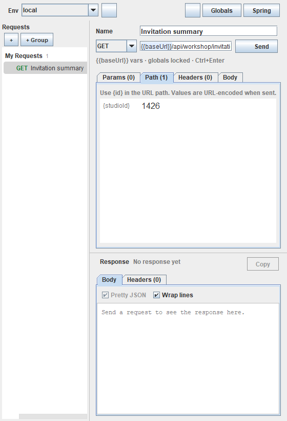
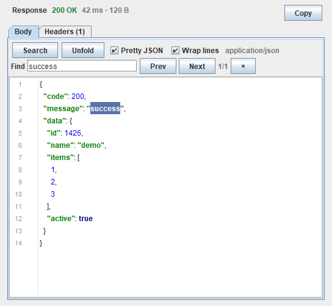

# Smart Request

[](https://github.com/liuzwei/smart-request/actions/workflows/build.yml)
[](LICENSE)
[](https://github.com/liuzwei/smart-request/releases)

一个运行在 IntelliJ IDEA 里的轻量 HTTP 客户端，用来快速测试 Java / Spring 项目中的 Controller。界面参考了 Postman 和 Cool Request，但实现完全独立。

当前仓库是一个可编译、可运行、可打包的版本，核心链路已经打通：**分组管理请求 → 选择环境 → 解析变量 → 替换 Path 参数 → 合并全局 Header/Params → 发送 HTTP 请求 → 展示响应 → 记录历史/缓存响应**，并支持 Spring Controller 一键导入、变量高亮和自动补全。

## 界面预览



> 截图展示了 Path 参数页、URL 高亮和请求树布局；实际颜色会跟随 IDE 主题变化。工具窗口可以向右拖动加宽，左侧请求树也可以拖动调整比例。

---

## 1. 技术选型：Kotlin + IntelliJ Platform SDK + Swing

推荐使用 **Kotlin** 开发这个插件，当前项目也已经按这个方案实现。

| 方案 | 评价 |
| --- | --- |
| **Kotlin + IntelliJ Platform SDK（推荐，已采用）** | JetBrains 官方主推的插件语言。调用 PSI、Project Service、ToolWindow、DialogWrapper 等平台 API 最自然，代码量比 Java 少很多；空安全、扩展函数、协程对后续做请求历史、并发任务、UI 状态管理都有帮助。UI 使用 Swing/IntelliJ UI 组件，和 IDE 原生风格一致。 |
| Java + IntelliJ Platform SDK | 完全可行，但样板代码多（Listener、Builder、ViewModel、序列化），PSI 操作更啰嗦。适合团队只写 Java 的情况。 |
| JavaScript/TypeScript + JCEF | 可以做出更接近 Postman 的 Web UI，但需要桥接 Kotlin/Java 后端、处理资源打包、主题同步、焦点和快捷键，插件体积和启动成本也更高。适合 UI 很复杂的成熟产品，不适合 MVP。 |
| 独立桌面/Web 应用 | 开发体验可能更自由，但失去“在 IDE 里直接测试当前项目 Controller”的最大优势。 |

结论：**Kotlin 负责插件逻辑和原生 UI，HTTP 层使用 JDK 自带的 `java.net.http.HttpClient`**。这样不需要引入 OkHttp/Jackson 等运行时依赖，插件包小，启动快。

> 构建目标：IntelliJ IDEA 2026.2+（`since-build=262`），JVM 25。当前机器上的 IDEA 自带 JBR 25，可以直接作为 Gradle JVM。

---

## 2. 当前已实现的功能

### 请求与分组

- 项目级请求树，支持一级分组（Group）。
- 新建、重命名、复制、删除请求；新建、重命名、删除分组。
- 右键请求 → `Move to Group` 可把请求移动到其他分组；也可以选择 `New Group…` 新建分组后直接移入。
- 请求编辑区：名称、HTTP Method、URL、Query Params、Path Params、Headers、Body。
- 支持 `GET / POST / PUT / PATCH / DELETE / HEAD / OPTIONS`。
- 表格行支持启用/禁用，禁用行不会发送。
- 删除请求/分组前有确认提示。
- 分组展开状态持久化。

### 路径参数（Path）

- 在 URL Path 中写 `{studioId}`、`{id}` 这类占位符，插件会自动识别。
- 新增独立的 `Path Params` Tab，只允许编辑值，参数名锁定为 URL 中的占位符。
- URL 变化时自动同步：新增占位符会新增一行，删除占位符会移除旧行，同名参数保留已填的值。
- 发送前把值替换进路径，并按 **单个路径段** 做 URL 编码：
  - `a/b c` → `a%2Fb%20c`
- 路径参数值也支持环境变量，例如 `{id}` 的值为 `{{userId}}`。
- 路径参数缺失或为空时会在发送前报错，不会悄悄发出错误 URL。
- 路径占位符在 URL 输入框里会以绿色背景高亮。

### 变量高亮与自动补全

- URL、Header、Query Params、Path Params、Body 中所有 `{{variable}}` 都会高亮：
  - 蓝色：当前环境已定义。
  - 红色：当前环境未定义。
- URL 中的单花括号路径参数 `{id}` 使用绿色高亮，与 `{{environmentVariable}}` 区分。
- 在 URL、Body 中按 `Ctrl+Space` 可以弹出当前环境的变量列表。
- 在 URL、Body 中输入 `{{` 会自动弹出变量补全；选择后插入 `{{name}}`。
- Params / Headers / Path Params 的单元格编辑器里同样支持补全：输入 `{{` 自动弹出，或按 `Ctrl+Space` 主动触发；弹窗不会抢走单元格焦点，选中后继续在单元格里输入。
- 切换环境后，高亮颜色和补全列表立即刷新。

### 请求历史与响应缓存

- 每次请求完成（成功、HTTP 4xx/5xx、网络错误）都会记录一条历史：
  - 时间、Method、URL、状态码、耗时、响应大小、环境名
  - 请求快照（方法、URL、Path/Query/Header/Body）
- 历史保存在 `.idea/smart-request.xml`，最多保留最近 100 条。
- 点击工具栏历史图标打开 History 对话框：
  - 双击或 `Restore Request` 会把快照恢复成一个新请求，加入 `History` 分组。
  - `Clear History` 清空历史。
- 响应缓存：
  - 在同一个 IDE 会话中，每个请求会缓存最后一次响应。
  - 切换请求再切回来，不需要重新发送就能看到上次的状态、Header 和 Body。
  - 最多缓存 10 个请求的响应，内存中保存，不写入 `.idea`。

### 响应提取（Extract）

把响应里的值自动存进当前环境的变量，实现“登录拿 token → 下一个请求带上 token”的串联。

- 请求编辑器新增 `Extract` Tab：每条规则一行，`Variable` 是目标变量名，`Source` 是取值表达式。
- 点开 `Variable` 单元格会直接列出当前环境里已有的变量，点一下就能复用（例如 `x-code`），不用再敲一遍；
  也可以直接输入新名字，或按 `Ctrl+Space` / `Alt+↓` 或点右侧 `▾` 再次打开列表。输入 `{{x-code}}` 会自动去掉花括号。
- 每次请求完成（含 4xx / 5xx）自动执行；也可以在 Tab 里点 `Run now`，用上一次缓存的响应重跑，不必重新发请求。
- `Source` 语法：

  | 表达式 | 含义 |
  | --- | --- |
  | `data.token` | JSON Body 字段，逐级用 `.` |
  | `data.items[0].id` | 数组下标 |
  | `data.items[-1].id` | 倒数第一个元素 |
  | `data["user.name"]` | key 含 `.`、空格等特殊字符时用括号写法 |
  | `data` | 整个 Body（对象/数组压成紧凑 JSON） |
  | `headers.X-Request-Id` | 响应头，大小写不敏感 |
  | `status` / `statusText` | 状态码 / 状态短语 |

- 变量名留空时自动取路径最后一段：`data.user.id` → `id`，`headers.X-Request-Id` → `X_Request_Id`；特殊字符替换成 `_`。
- 写回规则：
  - 当前环境已有同名变量 → 更新值；被禁用的变量会重新启用。
  - 没有 → 追加到当前环境变量列表末尾。
  - 变量名是 `baseUrl` 时直接报错（它是 Host Address 的保留名）。
  - 提取失败（路径不存在、值为 `null`、Body 不是 JSON、Body 被截断、二进制响应）**不会覆盖旧值**，只在结果列显示原因。
- 响应区新增只读 `Variables` Tab，列出这次响应抓到的变量、值和结果；`Extract` Tab 的 `Last run` 列显示同样的结果，悬停可以看到 `旧值 → 新值`。
- 写入的变量立即生效，`{{token}}` 的高亮与补全也会刷新。
- 变量保存在 `.idea/smart-request.xml` 中，属于**明文**存储，注意不要提交真实 token。

### 复制为 cURL

- 在请求树中右键请求 → `Copy as cURL`，支持：
  - `Linux / macOS`
  - `PowerShell`
- 生成的是**解析后**的最终请求，包含：
  - 当前环境 `baseUrl`
  - Path 参数
  - 全局/请求 Query 参数
  - 全局/请求 Header
  - Content-Type、User-Agent
  - Body（`--data-raw`）
- Linux 使用 POSIX 单引号转义；PowerShell 使用 `curl.exe` 和 PowerShell 单引号转义。
- 自动跟随重定向时加上 `--location`。
- 复制成功会弹出提示，并写入系统剪贴板。

### 环境（Environment）

- 环境列表：local、dev、test、prod 等，可新增、复制、删除。
- 每个环境包含：
  - 环境名称
  - Host Address（即 `baseUrl`）
  - 任意数量的变量，例如 `token`、`tenantCode`、`userId`
- 顶部工具栏切换环境，立即影响下一次请求。
- 环境变量支持递归解析，例如：
  ```text
  baseUrl = http://localhost:8080
  api = {{baseUrl}}/api
  users = {{api}}/users
  ```
  请求里写 `{{users}}` 会解析成 `http://localhost:8080/api/users`。
- `{{baseUrl}}` 会自动去掉末尾 `/`，避免拼出 `//api`。

### 全局 Header 和全局 Params（锁定）

- Global Settings 中维护全局 Header 和全局 Query Param。
- 全局 Header 适合放 `Authorization`、`Token`、`X-Tenant-Code` 等。
- 全局 Param 会追加到每个请求的 URL 查询参数中。
- 在请求编辑器的 Params / Headers 表格里，全局行以灰色斜体显示，来源列标记为 `Global`，不可编辑、不可删除。
- 同名时请求级参数优先：
  - 请求 Header `Authorization` 覆盖全局 `Authorization`。
  - 请求 Param `page=2` 覆盖全局 `page=1`。
- 全局设置还包含请求超时（默认 30s）和是否跟随重定向。

### 参数表格输入体验

Params / Headers / Path Params 共用同一套表格交互：

- 列宽按 `Key : Value = 3 : 4` 分配，并随工具窗口宽度实时伸缩，表格右侧不再留一条空白。
- Key 列足够宽，`Authorization`、`X-Tenant-Code` 这类名字不会再被截断成 `author...`。
- 单元格平时是只读文本，**单击**即进入编辑态并全选内容，直接输入即可覆盖；`Enter` 提交，`Esc` 取消。
- 点击别的单元格、别的 Tab 或 `Send` 时编辑器才关闭，不会出现"闪一下就退出编辑"的情况。
- 输入过程中每个字符都会写回模型，即使编辑器被别的事件打断，已输入的内容也不会丢失。
- 单击最左侧勾选框即可启用/禁用该行，不需要双击。
- 有内容的单元格悬停显示完整文本，长 Token 不进编辑态也能看全。
- 全局行（来自 Global Settings）显示为灰色斜体、不可编辑，悬停会提示去 Global Settings 修改。
- 窄窗口下按列的最小宽度收缩，不会把某一列压成 0。
- Path Params 表格按 `3 : 7` 分配，只有值列可编辑。

### URL 与 Params 双向同步

- URL 和 `Params` 表格现在是同一份数据的两个视图，任意一侧改动都会立刻同步到另一侧。
- 在 URL 里输入 `?page=2&size=10`，切到 `Params` 会看到两行参数；反过来在表格里加一行、改值或取消勾选，URL 里的查询串也会实时更新。
- URL 里的百分号转义会自动解码成可读文本（表格里显示 `hello world`），写回 URL 时再编码；`{{变量}}` 保持原样，不会被编码。
- 被取消勾选的行会从 URL 里移除，但**保留在表格中**；重新勾选后按原来的位置回到 URL。
- 删除表格行或从 URL 中删掉某段查询串，另一侧会同步删除对应参数。
- 打开旧版本保存的请求时，如果查询串只在 URL 或只在参数表里，会先把两边合并再规范化，不会丢参数。
- 发送时以参数表为准：参数（含全局参数）解析变量后会重新编码写入查询串，不会出现重复参数。

### HTTP 请求与响应

- 基于 `java.net.http.HttpClient`，异步发送，不阻塞 EDT。
- 发送中按钮变为 Cancel，可以取消请求。
- 支持 URL 中已有 Query 参数；参数表与 URL 同步后，发送时以参数表为准重新编码。
- Body 类型：
  - None
  - JSON（默认 `application/json`）
  - Text（默认 `text/plain`）
  - XML（默认 `application/xml`）
  - Form URL Encoded（默认 `application/x-www-form-urlencoded`）
- Body 快速生成：
  - 从 Gutter 生成 `@RequestBody` 请求时，自动根据 DTO 字段生成 JSON 骨架。
  - 支持嵌套对象、List/Set/Map、枚举、日期时间。
  - 支持 `@Schema(example/name/defaultValue)`、`@ApiModelProperty(example)`、`@JsonProperty`、`@JsonIgnore`。
  - 在 Body Tab 点 `From Params`，可以根据当前启用的 Query 参数生成 JSON 对象；数字、布尔值和嵌套 JSON 会保留类型。
  - 生成的是可编辑模板，复杂业务默认值仍需自行调整。
- 自动补 `User-Agent: Smart-Request/1.0`。
- 过滤 `Host`、`Content-Length`、`Connection` 等由 HttpClient 管理的受限 Header。
- 响应展示：
  - 状态码 + 原因短语
  - 耗时
  - 响应大小
  - 响应 Headers
  - JSON Body 语法高亮（字符串、数字、布尔、null、字段名）
  - `Fold` / `Unfold` 折叠嵌套对象和数组；折叠后保留行号
  - 响应体超出可视区域时显示滚动条：鼠标滚轮纵向滚动，`Shift + 滚轮` 横向滚动；关闭自动换行后也能查看超长单行
  - `Search` 或 `Ctrl+F` 搜索响应体：实时高亮、`Prev` / `Next`、`1/N` 计数，最多高亮 500 个匹配
  - Body 自动识别 JSON 并格式化，可关闭 Pretty JSON、开启自动换行
  - JSON Body 一键格式化
  - 复制响应体
- 支持 gzip / deflate 响应解压。
- 响应体超过 5MB 截断显示，避免拖死 IDE。
- 网络错误会给出可读提示，例如连接失败时提示检查应用是否启动、环境地址是否正确。



### Spring Controller 导入

- 工具栏 `Spring` 按钮扫描项目中的 Spring MVC Controller。
- 识别：
  - `@RestController`、`@Controller`
  - `@RequestMapping`、`@GetMapping`、`@PostMapping`、`@PutMapping`、`@PatchMapping`、`@DeleteMapping`
  - 类级 + 方法级路径组合
  - 多路径、多 HTTP Method
  - `{id:\\d+}` 这类路径正则，导入时转换为 `{id}`
- 导入到 `Spring Controllers` 分组；重复导入会按稳定 key 更新已有请求，不会重复创建。
- 扫描在后台任务 + ReadAction 中执行，不阻塞 UI。
- 右键分组也可以把接口导入到指定分组。

### 编辑器 Gutter 图标

Java Controller 的**类名**和带 Mapping 注解的**方法名**左侧会显示 Smart Request 图标：

- **类名图标**：生成/更新这个 Controller 的分组，以及分组下所有接口。
- **方法名图标**：只生成/更新当前这一个方法对应的请求。
- 分组名使用 Controller 类名，例如 `WorkshopInvitationInfoController`。
- 请求会自动带上：
  - HTTP Method
  - `{{baseUrl}}` + 类级/方法级完整路径
  - URL 中的 Path 参数名（值留空）
  - `@RequestParam` 的查询参数名；有 `defaultValue` 时填入默认值；未加注解的 String/int 等简单类型参数也会作为查询参数生成
  - `@RequestBody` 时自动根据 DTO 字段生成 JSON 骨架；支持嵌套对象、集合、枚举、`@JsonProperty`、`@Schema(name/example/defaultValue)`、`@ApiModelProperty(example)`
  - 请求名优先取 Swagger `@Operation(summary=...)` / `@ApiOperation(value=...)`，没有则用方法名
- 点击图标后会自动打开工具窗口并选中生成的请求。
- 重复点击同一个方法/类不会重复创建请求，只按稳定 key 更新；用户填过的 Path/Query 值、额外参数、Header、Body 会保留。
- 图标位于代码行左侧的 Gutter（行号右侧），不是紧贴类名/方法名文本。
- 当前只支持 Java Controller；Kotlin Controller 和自定义组合注解暂不显示图标。
- 如果 0.3.0 看不到图标，请升级到 0.3.2：0.3.0 的 Gutter 渲染器在 IDEA 2026.2 上会触发兼容性异常，0.3.1 起已改用平台标准 `GutterIconNavigationHandler`。

### 持久化

数据保存在项目目录：

```text
.idea/smart-request.xml
```

包含环境、全局 Header/Params、分组和全部请求，以及最近 100 条请求历史。适合跟着项目一起提交到 Git。

> 注意：环境变量、Header 和请求历史快照目前都是明文存储，历史快照可能包含 Token/Body。生产 token 不建议直接提交；后续计划接入 IntelliJ `PasswordSafe`。

### 响应缓存

响应缓存只在当前 IDE 会话内有效，保存在内存中，不会写入 `.idea`，重启 IDE 后需要重新发送请求。

---

## 3. 快速开始

### 环境要求

- IntelliJ IDEA 2026.2 或更高版本
- JDK 25（可以直接使用 IDEA 自带的 JBR）

检查 JBR：

```powershell
& "C:\Program Files\JetBrains\IntelliJ IDEA OSS\jbr\bin\java.exe" -version
```

### 运行插件（开发模式）

在项目根目录执行：

```powershell
$env:JAVA_HOME = "C:\Program Files\JetBrains\IntelliJ IDEA OSS\jbr"
.\gradlew.bat runIde -PlocalIdePath="C:\Program Files\JetBrains\IntelliJ IDEA OSS"
```

说明：

- `-PlocalIdePath=...` 表示直接使用本机安装的 IDEA 作为开发平台，避免重新下载完整 IDE。
- 如果不传这个参数，Gradle 会下载 `intellijIdea("2026.2.2")`，第一次会比较慢。
- 也可以把路径写进 `gradle.properties`：
  ```properties
  localIdePath=C:/Program Files/JetBrains/IntelliJ IDEA OSS
  ```

启动后，在 IDEA 右侧边栏找到 **Smart Request** 工具窗口；也可以从 `Tools → Smart Request` 打开。

### 安装到日常使用的 IDEA

```powershell
$env:JAVA_HOME = "C:\Program Files\JetBrains\IntelliJ IDEA OSS\jbr"
.\gradlew.bat buildPlugin -PlocalIdePath="C:\Program Files\JetBrains\IntelliJ IDEA OSS"
```

产物：

```text
build/distributions/smart-request-<version>.zip
```

在 IDEA 中打开 `Settings → Plugins → ⚙ → Install Plugin from Disk...`，选择这个 zip，重启即可。

### 自动构建与发布（GitHub Actions）

仓库自带 `.github/workflows/build.yml`，不需要预装 IDEA，runner 只用 JDK 25，IntelliJ Platform 由 Gradle 自动下载：

- push 到 `main`、PR、手动触发：执行 `./gradlew buildPlugin`，把 zip 作为 artifact 上传；
- push `v*` 形式的 tag：额外创建一个 GitHub Release，并把 zip 作为附件上传。

发版流程：

```powershell
# 1. 改 build.gradle.kts 里的 version，例如 1.0.2，然后提交推送
git commit -am "Bump version to 1.0.2"
git push

# 2. 打 tag 并推送（tag 名与版本号保持一致）
git tag v1.0.2
git push origin v1.0.2
```

说明：

- Release 使用仓库自带的 `GITHUB_TOKEN`，无需额外配置 secret；`release` job 声明了 `contents: write` 权限。
- 同一个 tag 重跑工作流时，会用 `gh release upload --clobber` 覆盖已有的 zip，不会因为 Release 已存在而失败。
- 只有 `v*` 的 tag 会发 Release；普通 push/PR 只做构建检查。
- 工作流文件也跟随 tag：改了 `.github/workflows/build.yml` 之后，需要把 tag 移到新提交（`git tag -f` + 强推）或者重新打一个 tag，旧 tag 的 workflow 还是旧的。
- 测试不在 CI 里跑：UI 测试会真的开 Swing 窗口，需要虚拟显示，必要时用 `xvfb-run --auto-servernum ./gradlew test`。

> **从 Fast Request 升级：** 插件 ID 从 `dev.fastrequest.idea` 改成了 `dev.smartrequest.idea`，IDEA 会把它当作一个新插件。请先在 `Settings → Plugins` 里卸载旧的 **Fast Request**，再安装这个 zip，否则会同时存在两个工具窗口。
>
> 项目数据会自动迁移：打开项目时仍会读取 `.idea/fast-request.xml`，下次保存时写入 `.idea/smart-request.xml`，环境、分组、请求、历史都不会丢。确认无误后可以删掉旧文件。

### 从 Fast Request 改名

| 旧 | 新 |
| --- | --- |
| 插件名 `Fast Request` | `Smart Request` |
| 插件 ID `dev.fastrequest.idea` | `dev.smartrequest.idea` |
| 包名 `dev.fastrequest` | `dev.smartrequest` |
| 主类 `FastRequestPanel` / `FastRequestState` / `FastRequestProjectService` | `SmartRequestPanel` / `SmartRequestState` / `SmartRequestProjectService` |
| 状态文件 `.idea/fast-request.xml` | `.idea/smart-request.xml`（自动迁移） |
| 构建产物 `fast-request-<version>.zip` | `smart-request-<version>.zip` |
| `User-Agent` | `Smart-Request/1.0` |

### 测试

```powershell
$env:JAVA_HOME = "C:\Program Files\JetBrains\IntelliJ IDEA OSS\jbr"
.\gradlew.bat test -PlocalIdePath="C:\Program Files\JetBrains\IntelliJ IDEA OSS"
```

当前测试覆盖（167 个）：

- 变量解析、递归、未知变量、循环
- URL 拼接、编码、已有 Query、非法 URL
- 路径参数的识别、替换、路径段编码、缺失/空值校验
- 全局/请求 Header、Params 合并
- 请求体 Content-Type 与变量解析
- JSON 格式化
- 响应提取：JSON 路径求值（嵌套、下标、负下标、括号 key、null、缺失、非 JSON、大整数精度）、提取引擎（新增/更新/重新启用/失败不覆盖/headers/status/派生变量名）、两个 Tab 的计数与结果展示
- Spring 路径拼接、路径正则清理
- 用 PSI 扫描真实的 `@RestController` / `@RequestMapping` / `@GetMapping` 注解结构
- 从方法生成请求：Method/URL/Path 参数/`@RequestParam`/`@RequestBody`/Swagger summary
- 从 DTO 字段生成 Body：嵌套对象、集合、枚举、Swagger example/name、从查询参数生成 JSON
- cURL 生成：Linux/PowerShell、单引号转义、HEAD、重定向参数
- 响应 JSON 编辑器：折叠/展开、搜索高亮与 `1/N` 计数
- 长响应体的滚动：滚动条在需要时可见、拖动/滚轮能滚动到响应末尾
- 类/方法 Gutter 图标存在性
- Controller 分组导入的创建、幂等更新、保留用户已填值
- 真实本地 HTTP Server 的 GET/POST、gzip 解压、错误状态码
- `.idea/smart-request.xml` 对应模型（含 Path 参数、History 快照）的 XmlSerializer 往返测试
- 请求在分组间移动：追加顺序、空分组、同一分组/无效 ID 的空操作、监听通知
- 请求右键菜单 `Move to Group` 的子菜单内容与回调
- 变量高亮、Path 参数自动同步
- 表格列宽：3:4 比例、随宽度伸缩、窄窗口最小宽度、铺满整个表格宽度
- 表格交互：单击进入编辑态、编辑器在表格布局变化时不被关闭、单击勾选框切换启用、全局行只读、新增行可立即编辑
- 单元格变量补全：请求补全后单元格仍保持焦点、编辑器被关闭时已输入文本不丢失
- URL 与 Params 双向同步：URL 改表格跟着变、表格改 URL 跟着变、取消勾选保留行、旧数据合并、重复参数不重复发送
- Query 字符串工具：解析/编码/解码、重复 key、无值 key、fragment、`{{变量}}` 不被编码、往返一致
- Path Params 表格的 3:7 列宽、只有值列可编辑、从 URL 识别参数
- 切换请求时变量输入框文本替换的边界回归测试
- 在真实 IntelliJ 项目中创建并销毁整个工具窗口与 History 对话框的 UI smoke test

---

## 4. 使用说明

### 第一次使用

1. 打开 `Smart Request` 工具窗口。
2. 顶部 `Env` 选择 `local`，点 `Environments` 修改 Host Address，例如 `http://localhost:8080`。
3. 在左侧 `My Requests` 分组里选中 `Health check`，把 URL 改为你的接口。
4. 点 `Send`，或按 `Ctrl+Enter`。
5. 在下方 Response 区查看状态、耗时、Header 和 Body。

### 变量

在环境里定义：

| Key | Value |
| --- | --- |
| `token` | `abc123` |
| `tenantCode` | `zoogoo` |

请求中写：

```text
{{baseUrl}}/api/users?tenant={{tenantCode}}
```

Header：

```text
Authorization: Bearer {{token}}
```

优先级：请求级 Header/Param > 全局 Header/Param；环境变量中显式定义的 `baseUrl` 会覆盖 Host Address。

### 路径参数

URL 示例：

```text
{{baseUrl}}/api/workshop/invitation-info/summary/{studioId}
```

切到 `Path Params` Tab，会看到自动生成的 `studioId` 行，填入 `1426` 后发送：

```text
http://localhost:9410/api/workshop/invitation-info/summary/1426
```

修改 URL 时 Path 表格会自动增删行；路径参数值支持 `{{变量}}`。

### 变量补全与高亮

- URL / Header / Params / Path / Body 中的 `{{}}` 都会高亮。
- 在 URL、Body、以及 Params / Headers / Path Params 的单元格里输入 `{{` 会弹出当前环境的变量名。
- 也可以按 `Ctrl+Space` 主动触发（URL、Body、单元格编辑器）。
- 已定义变量蓝色高亮，未定义变量红色高亮；URL 中的 `{id}` 绿色高亮。
- 切换环境后颜色和补全列表立即更新。

### 从响应中提取变量（Extract）

场景：`POST /login` 返回 `{"data":{"accessToken":"..."}}`，后续所有请求都要带 `Authorization: Bearer {{token}}`。

1. 选中登录请求，切到 `Extract` Tab，点 `+`。
2. `Source` 填 `data.data.accessToken`；变量名留空会自动变成 `accessToken`，也可以手动改成 `token`。
3. 点 `Send`。响应回来后 `Last run` 列显示 `Added`，响应区 `Variables` Tab 里能看到具体值。
4. 在别的请求 Header 里写 `Authorization: Bearer {{token}}`，直接发送即可。
5. 之后再发送登录请求会刷新这个变量；勾掉行首勾选框可以临时停用某条规则。

提取失败时旧值会被保留，例如接口临时返回 `{"data":null}`，不会把可用的 token 冲掉。

### 移动请求到其他分组

1. 在左侧请求树右键要移动的请求。
2. 打开 `Move to Group` 子菜单，点击目标分组。
3. 也可以选择 `New Group…`，输入分组名后新建分组并直接移入。
4. 请求会追加到目标分组末尾，目标分组自动展开；当前打开的请求和响应缓存不受影响。

### 编辑 Params / Headers

1. 切到 `Params` 或 `Headers` Tab。
2. **单击** Key 单元格即进入编辑态并全选内容，直接输入参数名；`Enter` 提交，`Esc` 取消。
3. 单击同一行的 Value 单元格输入参数值。
4. 单击行首勾选框可以临时禁用某一行，禁用的行不会发送，也不需要删除。
5. 点 `+` 新增一行并自动进入 Key 编辑；选中行后点 `−` 删除。
6. 灰色斜体行是全局参数，鼠标悬停可看到完整值，需要到 `Global Settings` 修改。

### URL 和 Params 怎么配合

1. 在 URL 里直接敲 `?page=1&size=20`，`Params` Tab 会立刻出现两行。
2. 反过来，在表格里改值、加行、取消勾选，URL 里的查询串会同步更新，不需要两边各写一遍。
3. 取消勾选的行留在表格里（方便临时开关），但不会出现在 URL 中，也不会发送。
4. 发送前 `Send` 会提交正在编辑的单元格，按参数表重新生成查询串。

### 请求历史与响应缓存

- 每次请求结束都会写入历史（最近 100 条），包括失败请求。
- 点工具栏最右侧的历史图标查看；默认最新的在最上面。
- 选择一条历史后点 `Restore Request`（或双击），会把请求快照恢复到 `History` 分组。
- 同一个 IDE 会话里切换请求不会丢失最后一次响应；最多缓存 10 个请求。

### Spring 接口导入

1. 确保项目里有 `spring-web` / `spring-boot-starter-web`。
2. 点工具栏 `Spring`。
3. 首次会创建 `Spring Controllers` 分组，按 Controller 方法生成请求。
4. 修改后的请求参数、Body、Header 不会被后续导入覆盖；导入只更新名称、Method、URL。

---

## 5. 项目结构

```text
src/main/kotlin/dev/smartrequest/
├── actions/                 # Tools 菜单打开工具窗口
├── editor/                  # Controller 类/方法 Gutter 图标
├── http/
│   ├── HttpTransport.kt     # java.net.http 封装、响应解码、gzip
│   ├── RequestPreparer.kt   # 变量解析、Header/Param 合并、校验
│   ├── RequestUrlBuilder.kt # URL 构建与编码
│   ├── QueryParams.kt       # URL 查询串与参数行的双向转换
│   ├── PathParameterResolver.kt # {path} 参数替换与编码
│   ├── CurlCommandBuilder.kt# Linux/PowerShell cURL 生成
│   └── VariableResolver.kt  # {{variable}} 递归解析
├── model/                   # 持久化模型（环境、请求、历史）
├── extract/                 # 响应提取：JSON 读取、路径求值、写回环境变量
│   ├── JsonPath.kt          # 无依赖 JSON 读取与 data./headers./status 路径求值
│   └── ResponseExtractorEngine.kt # 规则求值、失败不覆盖、变量写回与结果报告
├── service/                 # 项目级 PersistentStateComponent
├── spring/                  # Spring Controller PSI 扫描、请求生成/导入
│   ├── SpringEndpointScanner.kt
│   ├── SpringRequestFactory.kt
│   ├── SpringRequestBodyGenerator.kt
│   └── SpringRequestImporter.kt
├── ui/
│   ├── SmartRequestPanel.kt  # 主面板、发送流程、历史/响应缓存、Spring 导入
│   ├── RequestTreePanel.kt  # 左侧请求树
│   ├── RequestEditorPanel.kt# 请求编辑区
│   ├── PathParameterPanel.kt# Path 参数表格
│   ├── ResponsePanel.kt     # 响应展示
│   ├── KeyValueTablePanel.kt# 可复用 Key/Value 表格
│   ├── ExtractorTablePanel.kt# Extract 规则表格与上次执行结果
│   ├── TableLayout.kt       # 表格列宽比例分配与单击编辑
│   ├── VariableTextSupport.kt# 变量高亮与补全
│   ├── VariableHtml.kt      # 表格变量高亮
│   └── dialogs/             # 环境设置、全局设置、历史记录
└── util/JsonPrettyPrinter.kt# 无依赖 JSON 格式化
```

---

## 6. 设计上的几个取舍

1. **不用 Postman Collection 格式，先用项目级 XML**
   - 优点：零配置、直接跟随项目、读写简单。
   - 后续会增加 `.http` / Postman / OpenAPI 导入导出。

2. **不引入 OkHttp/Jackson**
   - 降低插件体积和依赖冲突风险。
   - JDK HttpClient 足够覆盖当前场景；复杂场景（HTTP/2、代理、Cookie、multipart）后续再评估。

3. **全局参数锁定在请求编辑器中**
   - 防止成员误改统一租户头/Token。
   - 请求级同名参数仍然允许覆盖，符合“统一默认 + 局部特例”的使用习惯。

4. **Spring 导入是“更新式”的**
   - 用 `Controller#method:HTTP:path` 作为稳定 key。
   - 只更新 Method/URL/Name，不覆盖用户编辑的 Body/Params/Headers。

5. **响应提取用声明式路径，而不是脚本**
   - 每条规则就是一个表达式 + 一个变量名，行为可预测，失败原因能一句话说清。
   - 不引入 JS 引擎或 JSONPath 依赖，插件体积和启动不受影响。
   - 代价是比脚本表达力弱：目前没有断言、条件、循环和数组批量提取。

---

## 7. 已知限制

- 只支持一级分组，暂不支持文件夹嵌套。
- 变量补全目前只提供环境变量名，不包含值的展示、分组或函数变量。
- 变量高亮是背景色标记，不是完整的语法高亮或快速修复。
- 响应缓存只在当前 IDE 会话有效，重启 IDE 后清空。
- 不支持 multipart/form-data、文件上传、二进制 Body。
- 不支持 Cookie 持久化、代理、自定义 SSL 证书、OAuth2 授权流程。
- 没有 pre-request / post-response 脚本、断言、批量 Runner；响应提取是声明式路径，只覆盖 JSON Body、响应头和状态码，暂不支持 XML、正则和数组批量提取。
- 环境变量和请求历史快照明文保存在 `.idea/smart-request.xml`，响应提取写入的变量同样如此。
- Spring 扫描只识别直接标注的注解，不识别自定义组合注解；Body 生成基于 DTO 字段和字段注解，不解析完整 Swagger/OpenAPI schema 或方法级 `@Operation` 里的 requestBody 示例。
- 表格行不支持拖拽排序，也不支持从剪贴板批量粘贴多行 `Key: Value`。
- URL 同步只覆盖 Query 部分；修改 URL 里的 Path `{占位符}` 会增删 Path Params 行，但反过来在表格里改不了 Path 名。

---

## 8. 后续路线图

### P0：把日常使用体验补齐

- 请求树搜索、过滤、嵌套分组、拖拽排序
- 表格行拖拽排序、从剪贴板批量粘贴 `Key: Value`
- 变量补全展示变量值/描述，支持路径参数和函数变量
- 请求级超时、环境级 Header、环境复制/导入导出
- 导入/导出 Postman Collection、`.http`、OpenAPI
- `.idea/smart-request.xml` 的迁移与版本兼容策略
- 历史记录筛选、按环境过滤、重新发送（Replay）

### P1：向 Postman 靠拢

- multipart/form-data、文件上传、binary Body
- Cookie 管理、代理、自定义 CA / 忽略证书校验
- Auth 助手：Basic、Bearer、API Key、OAuth2
- pre-request / post-response 脚本
- 断言与测试结果
- 批量 Runner / 按分组运行
- 敏感变量接入 `PasswordSafe`
- 从 Spring Controller 方法跳转到请求、从请求跳回源码

### P2：团队与工程化

- 环境变量分层（全局/项目/环境/请求）
- 请求依赖、链式调用
- gRPC / WebSocket / SSE
- 生成 Java/Kotlin/cURL 代码
- CI 中运行请求集合
- 插件市场发布、签名、自动更新

---

## 9. 已知问题与开发提示

- IDE 版本升级后如果 API 变动，优先检查 `plugin.xml` 中的 `since-build` 和 Gradle 中的平台版本。
- 使用 `localIdePath` 时，平台版本以本机 IDEA 为准；团队协作建议统一 `intellijIdea("2026.2.2")`。
- UI 代码全部运行在 EDT；HTTP 请求在后台线程，回调通过 `invokeLater` 回到 EDT。
- 新增持久化字段时，请给默认值并在 `SmartRequestState.normalize()` 中做兼容处理，避免旧 `.idea/smart-request.xml` 读取失败。

---

## 10. 参与贡献

构建、测试、代码约定和 PR 流程见 [CONTRIBUTING.md](CONTRIBUTING.md)。
安全问题请走 [SECURITY.md](SECURITY.md) 里的私密报告渠道，不要开公开 Issue。

## 11. License

本项目基于 [Apache License 2.0](LICENSE) 开源，Copyright 2026 liuzhaowei。
第三方商标说明见 [NOTICE](NOTICE)。

## 12. 免责声明

**使用前请阅读 [DISCLAIMER.md](DISCLAIMER.md)（完整版）。** 摘要：

- 软件按 **“现状”** 提供，不提供任何明示或暗示的担保，也不承诺支持或 SLA，使用风险自负。
- 插件会向你配置的 URL **真实发送 HTTP 请求**，可能创建、修改或删除服务端数据；
  由此造成的任何损失（数据丢失、业务中断、被第三方追责等）作者不承担责任。
- 环境变量、Token、请求体和请求历史以**明文**保存在 `.idea/smart-request.xml`，可能随 Git
  提交或项目共享而泄露；这类泄露及其后果由使用者自行承担。插件本身不收集遥测数据，除你配置的
  请求目标外不主动发起网络通信。
- 本项目是独立第三方插件，与 JetBrains s.r.o. 无隶属或背书关系；IntelliJ IDEA、JetBrains 是
  JetBrains s.r.o. 的商标，仅用于说明兼容性。
- 请确保你对目标系统发起请求的行为已获授权，并遵守所在地法律和所在组织的安全规范。
